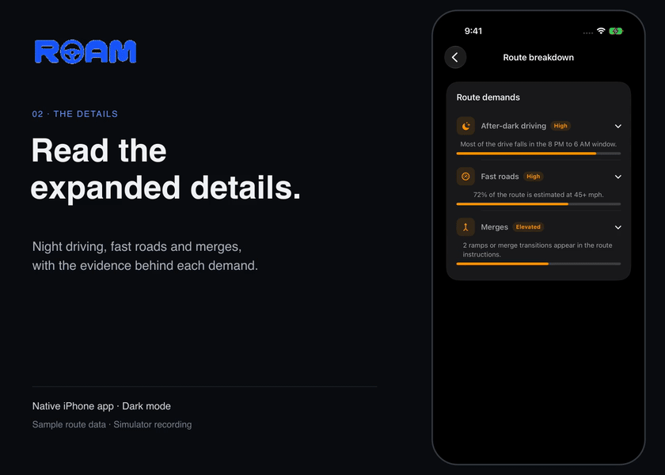
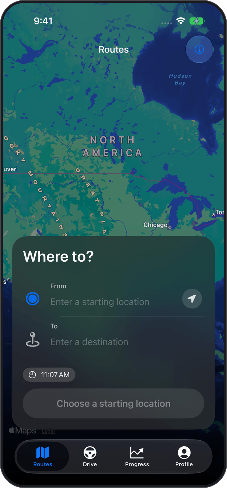
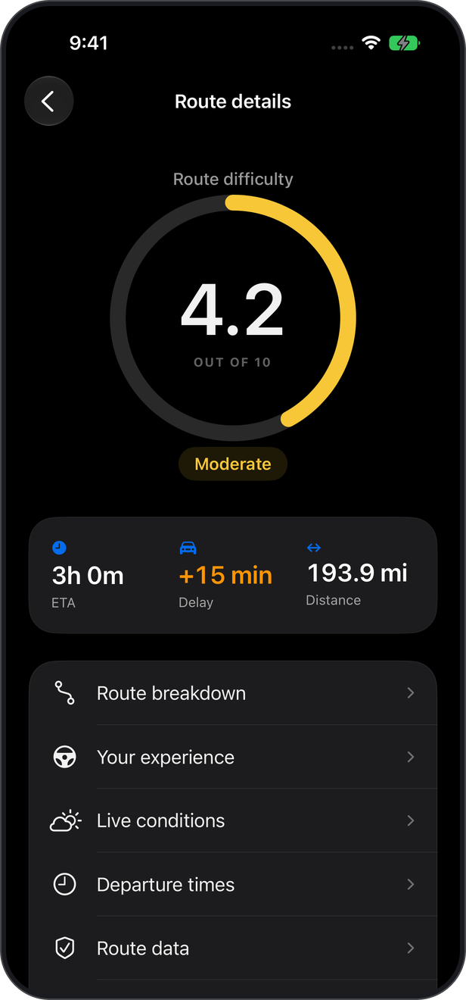
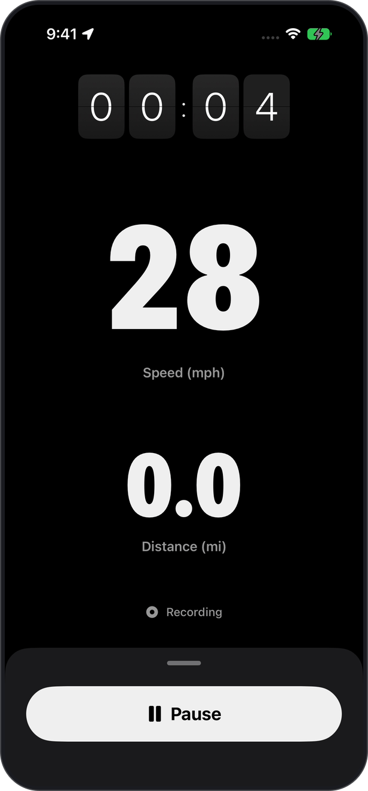
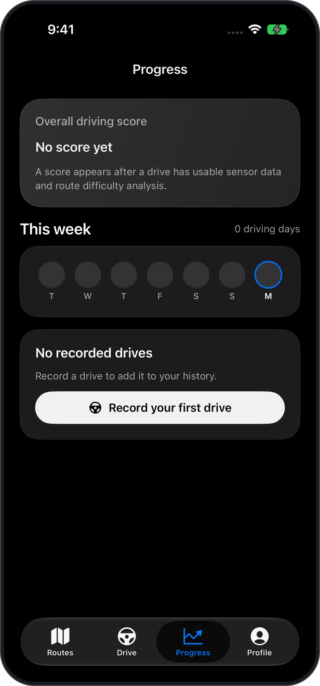
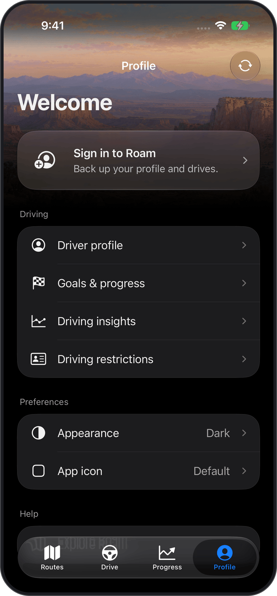
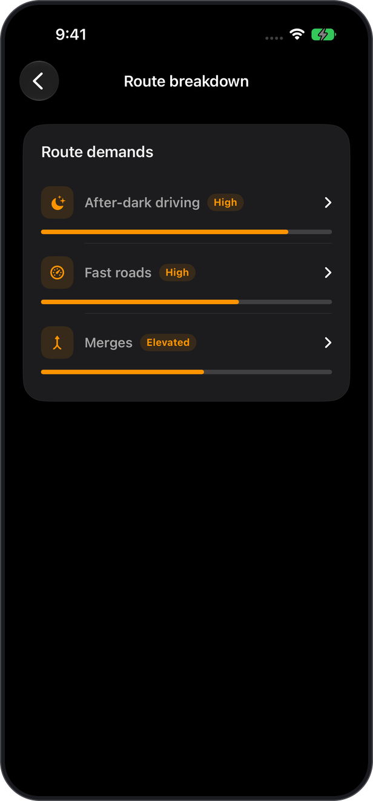
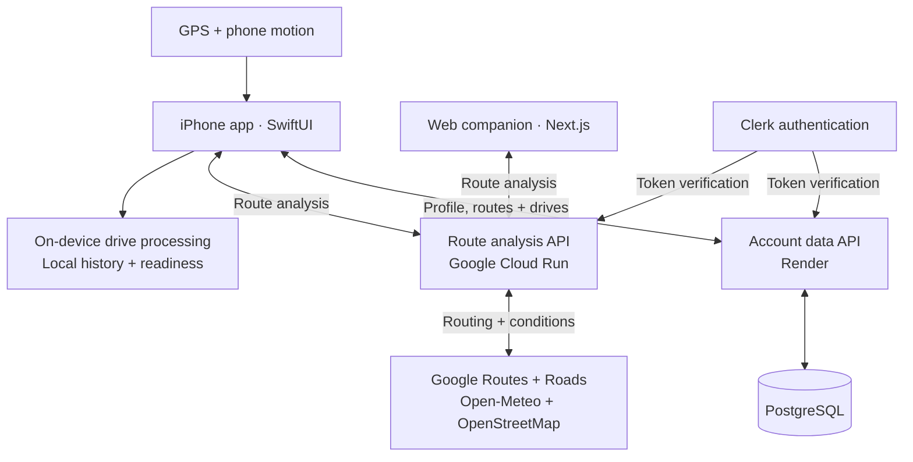

<div align="center">

<p>
  
  &nbsp;
  
  &nbsp;
  
</p>

<h1>Know what you're driving into.</h1>

<p>An iPhone driving coach for new drivers and the families helping them learn.<br />Plan a route, record a practice drive, and see what to work on next.</p>

<p><strong>2026 Congressional App Challenge</strong><br />California's 9th Congressional District</p>

<p>
  <a href="#walkthrough"><strong>Watch the app in use</strong></a>
  &nbsp; · &nbsp;
  <a href="#the-app">Explore the app</a>
  &nbsp; · &nbsp;
  <a href="#using-roam">How to use it</a>
  &nbsp; · &nbsp;
  <a href="#how-the-algorithms-work">The algorithms</a>
  &nbsp; · &nbsp;
  <a href="#tech-stack">Tech stack</a>
  &nbsp; · &nbsp;
  <a href="#run-it-locally">Run it locally</a>
</p>

</div>

## Walkthrough

<p align="center">
  <a href="docs/assets/readme/roam-walkthrough.mp4"></a>
</p>

[Watch the full app walkthrough](docs/assets/readme/roam-walkthrough.mp4)

Recorded from the native iPhone app in dark mode. The walkthrough opens route details, expands the explanations, checks conditions, edits a local profile, and uses the drive controls. Route analysis uses the app's sample data; the simulator recording demonstrates the controls and does not represent a real drive.

## The app

From choosing a route to building experience. Select any screen for the original, full-resolution capture.

<table>
  <tr>
    <td width="33%" valign="top" align="center">
      <strong>01 &nbsp; Plan the drive</strong><br /><br />
      <a href="docs/assets/readme/raw/routes.png"></a><br /><br />
      Choose a destination and departure time before heading out.
    </td>
    <td width="33%" valign="top" align="center">
      <strong>02 &nbsp; Understand the route</strong><br /><br />
      <a href="docs/assets/readme/raw/route-score.png"></a><br /><br />
      See the difficulty score and the reasons behind the result.
    </td>
    <td width="33%" valign="top" align="center">
      <strong>03 &nbsp; Practice with purpose</strong><br /><br />
      <a href="docs/assets/readme/raw/drive.png"></a><br /><br />
      Record speed, time, and distance, with pause and lock controls close by.
    </td>
  </tr>
  <tr>
    <td width="33%" valign="top" align="center">
      <strong>04 &nbsp; See the bigger picture</strong><br /><br />
      <a href="docs/assets/readme/raw/progress.png"></a><br /><br />
      Build a history of measured miles, weekly practice, and driving conditions.
    </td>
    <td width="33%" valign="top" align="center">
      <strong>05 &nbsp; Make it yours</strong><br /><br />
      <a href="docs/assets/readme/raw/profile.png"></a><br /><br />
      Keep your driver profile, preferences, and account in one place.
    </td>
    <td width="33%" valign="top" align="center">
      <strong>06 &nbsp; Look a little closer</strong><br /><br />
      <a href="docs/assets/readme/raw/route-breakdown.png"></a><br /><br />
      Read the expanded evidence behind each route demand.
    </td>
  </tr>
</table>

<sub>Captured in dark mode from the native SwiftUI app in the iPhone simulator. Route analysis uses sample preview data; the active drive uses simulated GPS. Profile and Progress show guest or first-use states.</sub>

## Tech stack

The native app, route analysis, and account storage work together through two APIs.

| Part | Built with | Responsibility |
| :--- | :--- | :--- |
| **iPhone app** | SwiftUI, MapKit, CoreLocation, CoreMotion | Planning, manual drive recording, on-device coaching, and progress. |
| **Route analysis** | TypeScript, Express, Google Cloud Run | Route difficulty, departure comparisons, and road and weather context. |
| **Account sync** | Clerk, Express, Render, PostgreSQL | Authenticated profiles, saved routes, and drive history. |
| **Web companion** | Next.js, React, Leaflet | A browser interface to the route analysis engine, available to run locally. |



The same backend code serves two deployments. Cloud Run handles route requests without a database; Render handles persistent account data. The iPhone app processes recorded drives and matches practice routes locally.

See the [deployment guide](docs/deployment.md) for service configuration.


## Why Roam

A route can be short and still ask a lot of a new driver: a busy left turn, an unfamiliar merge, or a stretch of road after dark. Roam helps a learner and their family make those demands part of the practice plan.

Before a drive, it explains the route and compares it with the driver's recorded experience. After a drive, it turns GPS and motion readings into feedback. Over time, those sessions build a clearer picture of what the driver has practiced and what deserves another try. Road difficulty, driving behavior, and accumulated practice each get their own explanation.

The goal is simple: make everyday practice more deliberate, and give families something concrete to talk through together.

## Using Roam

1. **Set up your driver profile.** Open **Profile** to add a name and licensing stage. Sign in to check routes and back up your profile, saved routes, and drive history.

2. **Plan a real trip.** In **Routes**, enter a starting point or choose your current location, then select a destination. Use **Leave now** or **Choose departure time**, then tap **Check route**. You can also share a route into Roam from Apple Maps or Google Maps.

3. **Look beyond the number.** Tap **View details**. **Route breakdown** explains demands such as merges, fast roads, and after-dark driving. **Your experience** compares those demands with your recorded practice. **Departure times** compares available options, and **Route data** shows the evidence behind the analysis. When alternate routes are available, compare their time, distance, and difficulty in the route overview.

4. **Turn the route into practice.** Select **Practice this route** to queue it and bring its goals into **Drive**. Secure the phone, grant the requested location and motion permissions, and tap **Start drive** before leaving. **Open in Maps** hands navigation to a maps app. Roam records the session with pause, resume, and control-lock options, plus support for a Live Activity and CarPlay dashboard.

5. **Review after parking.** End the session and choose **Review this drive** to examine the recorded trip and coaching events. **Progress** tracks measured miles, after-dark experience, faster-road exposure, and weekly practice. Drives need usable sensor data to qualify for coaching and readiness; an incomplete recording can remain in history without contributing a score.

For example, a learner could queue a route with several merges, practice it with an adult, and review the session afterward. The next route comparison can then draw on the experience recorded during that practice. A queued route counts as practiced only when a qualifying GPS trace sufficiently overlaps it.

## How the algorithms work

Roam uses explicit scoring rules, signal processing, and geometric matching. The interesting problems are deciding which parts of a route deserve more weight, separating vehicle behavior from sensor noise, and checking whether recorded practice actually covered the planned road.

| Engine | Question it answers | Result |
| :--- | :--- | :--- |
| **Route difficulty** | What does this road, at this departure time, ask of a driver? | A difficulty score from 0 to 10, with demands, explanations, and input coverage. |
| **Drive coaching** | What happened during a recorded session? | Distance-normalized event feedback and a coaching score when the evidence supports one. |
| **Progress and readiness** | How does recorded experience compare with the next route? | A route-adjusted progress score, experience comparisons, and practice suggestions. |

<details>
<summary><strong>Route scoring: difficult sections, maneuver clusters, and conditions</strong></summary>

The backend turns navigation steps into features including highway share, speed exposure, merge spacing, turn clusters, traffic delay, road conditions, and expected after-dark exposure. Many inputs use the bounded smoothstep function `h(t) = t²(3 - 2t)`, with `t` clamped between 0 and 1. This makes the burden increase gradually around a threshold.

Steps are grouped into segments using duration and distance rules. Each segment gets a local workload score. Their aggregate deliberately includes the hardest sections:

```text
segmentWorkload = 0.55 × mean(segmentScores)
                + 0.25 × percentile90(segmentScores)
                + 0.20 × max(segmentScores)
```

The average describes the overall trip; the upper percentile and maximum keep a demanding interchange or turn cluster visible within a mostly easy route.

Spacing matters too. The merge-spacing calculation includes `exp(-gapMeters / 800)` for successive merges or ramps, so nearby decisions contribute more than widely separated ones. Turn clustering has its own spacing and decision-density features.

The structural base combines normalized speed, merge, turn, traffic, and length or monotony components:

```text
structuralBase = 0.24 × speed + 0.26 × merges + 0.22 × turns
               + 0.14 × traffic + 0.14 × lengthAndMonotony
```

These are intermediate components. The final pipeline combines segment workload with timing, fatigue, sustained effort, and interactions between conditions, then adds duration, maneuver, weather, road, and traffic contributions. A bounded, piecewise linear calibration maps the result onto the 0 to 10 scale, rounded to one decimal place.

The response includes reasons, ranked contributions, demanding sections, and data coverage. Missing posted-speed coverage can fall back to speeds inferred from route timing. Departure comparisons rerun the analysis for each candidate time and preserve successful results when another candidate is unavailable.

Read the [feature extraction](backend/src/scoring/features.ts), [segment aggregation](backend/src/scoring/segments.ts), [merge and maneuver signals](backend/src/scoring/signals.ts), [workload model](backend/src/scoring/fatigue.ts), and [evidence assessment](backend/src/scoring/certainty.ts).

</details>

<details>
<summary><strong>Sensor processing: usable GPS, acceleration, and event detection</strong></summary>

CoreMotion samples device motion at **20 Hz**. Gravity-free acceleration is rotated into a vertical reference frame before measuring horizontal acceleration, reducing dependence on how the phone is oriented.

GPS fixes need valid speed and timestamps and horizontal accuracy within **35 meters**. Consecutive points must be **0.5 to 5 seconds** apart and pass a displacement check:

```text
distance <= 2.4 × max(previousSpeed, currentSpeed) × elapsedTime + 80 meters
```

Speeds are in meters per second. This check rejects implausible location jumps. Longer gaps split the trace, so missing readings do not turn into invented mileage.

Maneuver detection calculates acceleration as `changeInSpeed / elapsedTime`. Current thresholds include hard braking at or below **-3.2 m/s²**, rapid acceleration at or above **2.8 m/s²**, and cornering at or above **28° per second**, subject to speed, course-accuracy, and event-validity checks. A median of nearby motion samples can corroborate a GPS event.

Phone movement uses a sustained acceleration-and-rotation pattern, an abrupt peak, recent GPS, and a moving vehicle. A single motion sample cannot satisfy that detector. The result is a phone-movement coaching event, not a measurement of what the driver was doing with the phone.

Read the [session manager](ios/Roam/Services/DriveSessionManager.swift), [event and quality checks](ios/Roam/Models/DriveScoringEngine.swift), and [phone placement analysis](ios/Roam/Models/PhonePlacementAnalyzer.swift).

</details>

<details>
<summary><strong>Coaching scores: event rates, route difficulty, and evidence weights</strong></summary>

The base drive score normalizes events to ten miles. A three-mile denominator floor keeps one event on a brief trip from producing an extreme rate:

```text
rateFactor = 10 / max(3, measuredMiles)

penalty = min(55, rateFactor × (
    3.5 × hardBrakes + 2.5 × rapidAccelerations
  + 2.25 × sharpCorners + 0.75 × phoneMovements
))

baseScore = round(100 - penalty)
```

Confidence is calculated separately from the score, using usable trace time, distance, accepted and rejected GPS fixes, and motion samples. A recording can remain in history while the UI withholds its score because the evidence is too weak.

The **Progress** score adjusts each qualifying session using independently analyzed route difficulty, then combines sessions with data-quality, distance, recency, and difficulty weights. Distance weighting uses a bounded square-root function, preventing a single long drive from dominating the history. Recency follows a **120-day half-life**. Locally estimated route difficulty has less influence than route-service analysis.

Read the [base scoring and confidence logic](ios/Roam/Models/DriveScoringEngine.swift) and [route-adjusted performance engine](ios/Roam/Models/DriverPerformanceEngine.swift).

</details>

<details>
<summary><strong>Readiness: recent experience and direction-aware route matching</strong></summary>

Readiness builds an experience profile from qualifying drives. Each needs medium or high data confidence and either **five usable minutes or one measured mile**. The initial history gate also requires three qualifying drives on three days, 15 reliable miles, 45 usable minutes, and sufficient recent evidence.

The profile separates after-dark driving, faster-speed exposure, sustained driving, and verified practice demands. Older exposure contributes less:

```text
effectiveMiles = sum(miles × 0.5^(ageDays / 120))
```

Practice verification matches planned route samples against recorded trace segments in order. Samples must fall within **25 meters** and agree in travel direction within **60°**. The matcher advances through the recorded trace, so driving a road in reverse does not automatically earn the same match.

Whole-route completion needs at least **60% overall coverage**, **45% continuous coverage**, and **60% coverage in both endpoint windows**. Demand-specific evidence uses a separate **70% coverage threshold**. GPS gaps break continuity, preventing scattered fragments from counting as one continuous practice route.

When history or route evidence is insufficient, the result can request more recorded experience or suggest practicing with an adult. These are coaching comparisons; they have not been validated as crash predictions or a determination that someone is ready to drive independently.

Read the [readiness engine](ios/Roam/Models/DriverReadinessEngine.swift), [configurable evidence thresholds](ios/Roam/Models/DriverReadinessConfiguration.swift), and [ordered route matcher](ios/Roam/Models/DriverReadinessRouteMatcher.swift).

</details>

<details>
<summary><strong>Recording and personal data</strong></summary>

- **Recording starts manually.** Location and motion permissions support a session the driver chooses to start. Continuing that session with the screen locked uses background location.
- **Drive processing happens on the phone.** GPS quality checks, event detection, and readiness matching run locally.
- **Route analysis uses online services.** Route inputs go to the route API and its routing, road, and weather providers.
- **Signed-in data can sync.** Profiles, saved routes, and recorded drive data can be backed up through the authenticated account API. Account deletion controls are available in the app.

</details>

## Run it locally

The native app targets **iOS 26**. Use Xcode with the matching iOS SDK for the app, and **Node.js 22** with npm for the backend and web companion.

<details>
<summary><strong>Start the backend</strong></summary>

From the repository root:

```bash
npm --prefix backend ci
```

Create `backend/.env.local` with your own credentials:

```dotenv
GOOGLE_MAPS_API_KEY=your_google_maps_api_key
CLERK_SECRET_KEY=your_clerk_secret_key
```

```bash
npm run dev
```

The API listens at `http://localhost:3000`. Route analysis needs both keys and a valid signed-in Clerk session. Account endpoints also need `DATABASE_URL`; for a local PostgreSQL database, set `PGSSLMODE=disable` and run `npm --prefix backend run migrate`.

Keep credentials in the gitignored local environment file. See the [deployment guide](docs/deployment.md) for the full configuration.

</details>

<details>
<summary><strong>Open the iPhone app</strong></summary>

Open [ios/Roam.xcodeproj](ios/Roam.xcodeproj) in Xcode and select the **Roam** scheme. Copy the local API configuration template:

```bash
cp ios/Roam/Config/Debug.local.example.xcconfig ios/Roam/Config/Debug.local.xcconfig
```

Set the route and account API hosts in that local file, following the template's `.xcconfig` URL syntax. A physical iPhone needs hosts reachable from the device.

If you use your own Clerk application, update `Clerk.configure(publishableKey:)` in [RoamApp.swift](ios/Roam/RoamApp.swift) with its publishable key so native sign-in matches the backend's Clerk credentials.

Build and run on an iOS 26 simulator or compatible iPhone. Use a physical device to evaluate real GPS and motion behavior.

</details>

<details>
<summary><strong>Try the web companion</strong></summary>

```bash
npm --prefix web ci
```

Create `web/.env.local` with Clerk credentials from the same application as the backend:

```dotenv
NEXT_PUBLIC_CLERK_PUBLISHABLE_KEY=your_clerk_publishable_key
CLERK_SECRET_KEY=your_clerk_secret_key
NEXT_PUBLIC_ROAM_API_BASE_URL=http://localhost:3000
```

Use a separate port so the backend can stay on port 3000:

```bash
npm --prefix web run dev -- --port 3002
```

Open `http://localhost:3002` and sign in to analyze a route.

</details>

<details>
<summary><strong>Checks and tests</strong></summary>

Run from the repository root after installing dependencies:

```bash
npm test                           # Backend tests
npm run build                      # Backend TypeScript checks
bash ios/tests/run-checks.sh        # Swift model and engine checks
npm --prefix web run typecheck      # Web TypeScript checks
```

The Swift checks cover scoring, readiness, route matching, recording policies, and other app logic without launching a simulator. UI tests live in [ios/RoamUITests](ios/RoamUITests).

</details>

---

<p align="center">
  <strong>Roam</strong><br />
  Built for the first miles, and the practice that comes after.<br /><br />
  <a href="#walkthrough">Watch the app in use</a> · <a href="docs/driving-restrictions.md">Driving restriction sources</a> · <a href="LICENSE">MIT License</a>
</p>
