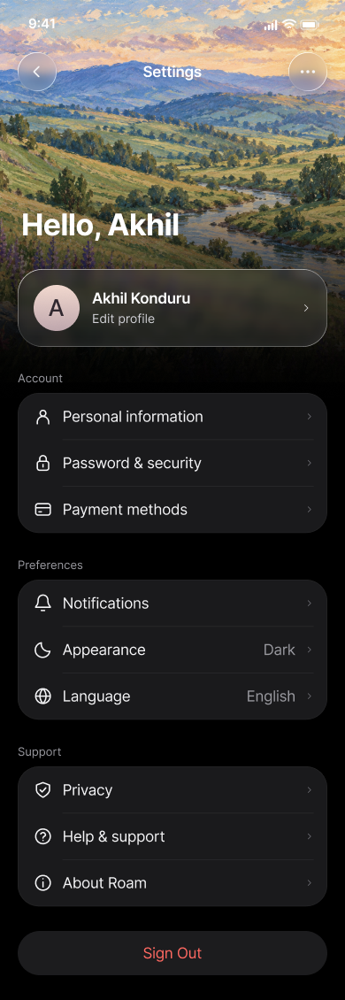

# Roam settings — design PRD and implementation brief

Status: implemented in SwiftUI; the raised-header revision passes a signed simulator build, three focused UI checks, and three driving-data / artwork / pull checks.
Date: October 15, 2026.

## The request

Redesign Roam’s Profile/settings experience to feel like a carefully made Apple app. A pastel landscape should fill the top of the screen, remain clear and detailed at the top, and gradually fade into the black page background. Place a personal greeting over the image. Use Liquid Glass for floating controls and the profile card, followed by compact, familiar groups of settings. Keep the writing direct and useful.

This is a refinement of the existing SwiftUI experience. Preserve real profile, driving, appearance, authentication, and sync behavior while changing its presentation.

## Design reference

- [Final Figma frame — Settings / Liquid Glass](https://www.figma.com/design/dVF2g22ZRiMrZ0TTgEWDE6/Untitled?node-id=4-2). File key: `dVF2g22ZRiMrZ0TTgEWDE6`; frame: `4:2`.
- [Guest state](https://www.figma.com/design/dVF2g22ZRiMrZ0TTgEWDE6/Untitled?node-id=14-84). The approved revision raises both account-state headers another 24 points in Figma. Native layout adapts that position to the device's safe area.
- [Apple Fitness account reference on Mobbin](https://mobbin.com/screens/f618bfa8-e996-4cb6-b7b8-f138e29963b1): compact grouped rows and restrained hierarchy.
- [BeReal settings reference on Mobbin](https://mobbin.com/screens/8468c58b-d7cb-48e2-aace-a69595ee584b): profile entry and grouped navigation.

Use the Figma frame as the visual reference. Use the existing app as the authority for supported features, navigation, account state, and data behavior. The frame includes illustrative settings rows; their presence does not authorize building new services.



## Visual requirements

### Landscape and fade

- Use the six generated landscapes bundled in the app, following the landscape direction in Figma. See [asset prompts and provenance](profile-landscape-assets.md). Do not use a screenshot of the complete interface as a background.
- Select a different landscape when Profile opens and when the app returns to the foreground with Profile visible. Persist the last choice to avoid an immediate repeat across launches. A glass refresh control also lets the user change it manually. This is local asset rotation, with no generation request or loading delay at runtime.
- Render it edge to edge behind the top safe area, with a deliberate crop and a softly pastel palette. Keep the upper part sharp; the requested fade changes opacity and darkness, not image resolution or sharpness.
- Transition continuously into black through a vertical gradient. Avoid a visible bottom edge, horizontal seam, or separate opaque panel covering the image.
- At the reference width of 390 points, the image occupies roughly the first 430 points. Keep the upper quarter mostly unobscured; increase darkness behind the greeting and reach solid black near the end of the header.
- Keep text readable over both bright sky and darker foliage. Tune the gradient rather than outlining every label or adding heavy text shadows.

### Greeting and profile

- For signed-in users, use `Hello, {firstName}` from the existing profile data. Use `Hello` when no usable name exists. Never hardcode Akhil or an account email.
- For guests, use `Welcome` and a glass `Sign in to Roam` card with `Back up your profile and drives.` Open the existing authentication sheet from this card. Keep local editing available through a separate `Driver profile` row in Driving. Hide account sync, sign-out, and deletion controls until signed in.
- Show a noninteractive progress card while restoring an account or signing in. Keep the signed-in profile card and account controls available for a restored offline session.
- The greeting should feel personal and prominent, approximately 34 points with a bold system weight.
- Keep the greeting close to the navigation controls: a 12-point gap below the top control row in the native layout. Remove the previous large block of empty landscape above the greeting.
- For signed-in and signed-in-offline sessions, place a three-column driving summary directly beneath the greeting and above the profile card: `Miles driven`, `Drives`, and `Days driven`. Use 25-point semibold values, 12-point labels, and modest spacing. Stack the metrics at accessibility text sizes. These values come from `DriverProfileInsights` and use the same qualifying recorded drives as Goals & progress. A new driver's values are zero; never copy illustrative Figma numbers into app state. Guests do not see this summary.
- Place the profile card below the greeting, partially over the fading landscape. Include an avatar or initials, the actual display name, an `Edit profile` label, and a disclosure indicator.
- Use a rounded, translucent material for the profile card with a subtle illuminated edge and visible landscape color underneath. Keep the name and action legible.
- The reference card is approximately 350 × 88 points with 20-point outer margins and a 28-point corner radius. Treat these as visual targets, not fixed dimensions at every text size.

### Liquid Glass and controls

- Use glass for floating navigation controls and the profile card. The landscape should be perceptible through the material.
- Keep highlights, refraction, and shadows restrained. Avoid strong rainbow edges, excessive distortion, neon glow, or glass on every surface.
- Settings groups should be quieter dark surfaces, approximately `#1C1C1E` against black, with soft corners and subtle inset separators.
- Use native SF Symbols, consistent optical sizes, and familiar disclosure indicators. Avoid text characters masquerading as icons.
- Floating controls need at least a 44 × 44-point touch target. Use a back button only when the screen has a real parent destination. Include an overflow control only when it has supported actions; do not ship decorative buttons.

### Typography, spacing, and copy

- Use the native Apple system font in the iOS app. Target roughly 17-point row labels, 13-point section labels, and 14-point secondary profile text. Support Dynamic Type.
- Figma currently uses Inter because SF Pro produced invisible text in the connector preview. This is a tooling fallback, not a requirement to replace the native app font.
- Use approximately 20-point outer margins, 24-point group corner radii, and 52-point rows at default text size. Let rows grow for larger text or wrapping.
- Use concise labels and show useful current values, such as the selected appearance, on the trailing side where space allows.
- Remove the earlier `YOUR SPACE` eyebrow, adventure tagline, and decorative brand footer. Avoid invented slogans, filler subtitles, unnecessary all-caps labels, and ornamental badges.

## Functional scope for the existing app

The current Profile tab contains driver identity, driving rhythm, goals/progress, driving insights, preferences, authentication, profile sync, drive-history sync, and account deletion. Keep those capabilities reachable during the redesign.

| Area | Implementation requirement |
| --- | --- |
| Identity | Reuse the existing display-name and licensing-stage model and editing rules. Open the existing editing flow from the profile card, or move it into a focused editor with equivalent behavior. |
| Driving features | Preserve access to Goals & progress and Driving insights. Keep the existing driving-rhythm and active-drive information available; do not discard it to match illustrative mockup rows. |
| Appearance | Reuse the current theme and app-icon pickers. Reflect the actual selection in summaries. Respect the selected theme; the supplied visual is the dark appearance reference. |
| Account | Keep sign-in, signed-in, restoring, authenticating, and signed-in-offline states accurate. Use the existing authentication flow. |
| Sync | Keep profile and drive-history sync status, failures, and retry actions visible and understandable. |
| Help | Preserve existing walkthrough/help entry points and route them to their working destinations. |
| Sign out | Show only when appropriate for the account state. Preserve loading and failure feedback and the existing sign-out behavior. |
| Delete account | Preserve the existing separate destructive action and confirmation, including its explanation of server deletion versus local data. |

The Figma rows for payment methods, notifications, language, password management, privacy, and About are visual examples. Before including any of them, verify that a real destination and behavior already exist. Omit unsupported rows from this implementation. Payments, localization, notification infrastructure, and new backend features require a separate product decision.

Keep the existing Profile tab location. The standalone Figma screen’s `Settings` title is a presentation reference; it does not require adding a fifth tab or restructuring the whole app.

## Interaction and accessibility

- Scroll the page naturally. Pulling down beyond the top expands the landscape and progressively blurs only the image, with a maximum 12-point blur. Keep the top covered and the labels sharp. Native scroll bounce returns the image to its original geometry and zero blur on release; ordinary upward scrolling stays sharp. Reduce Motion disables the extra zoom and blur. Avoid autonomous decorative motion.
- Give controls immediate, subtle press feedback. Respect Reduce Motion and Reduce Transparency; use a more opaque material when transparency is reduced.
- Make each row one clear accessible control with a useful label, current value, and action. Do not make VoiceOver announce decorative icons separately.
- Respect safe areas and the existing tab bar. Keep the final action reachable without being covered by system or app chrome.
- Preserve offline and error states. A visual refresh must not trigger new network requests during ordinary profile browsing or change how drive scores are calculated.

## Implementation guidance

Start by inspecting the current working tree, which already contains edits to several Profile and shared design files. Preserve and integrate those edits.

Relevant starting points:

- `ios/Roam/Features/Profile/ProfileView.swift` — screen, account states, sheets, sync, sign-out, deletion.
- `ios/Roam/Features/Profile/ProfileSupportingViews.swift` — existing profile presentation.
- `ios/Roam/Features/Profile/DriverProfile.swift` — identity and profile information architecture.
- `ios/Roam/Features/Root/ThemePickerSheet.swift` and `AppIconPickerSheet.swift` — existing preference destinations.
- `ios/Roam/Utilities/DesignSystem.swift` and `PremiumMotion.swift` — shared surfaces, spacing, and interaction conventions.

Build with semantic SwiftUI views and adaptive layout. Prefer native Liquid Glass APIs where the deployment target supports them, with availability checks and a material fallback for earlier supported versions. Reuse existing theme, authentication, persistence, and sync services. Do not flatten the screen into a single image or duplicate business logic inside the view.

The status bar in the Figma reference is illustrative. Let iOS render its real status bar; do not hardcode a time, battery, or signal indicators.

## Acceptance criteria

- [x] The landscape is detailed at the top and fades smoothly into black, with no seam or cutoff.
- [x] The greeting uses real profile data and remains readable over the image.
- [x] Floating controls and the profile card visibly use restrained glass material.
- [x] Settings groups have consistent alignment, row rhythm, icons, and inset separators.
- [x] Copy contains functional labels rather than promotional filler.
- [x] Guest actions, Driving destinations, preference sheets, and Help open and dismiss correctly; unsupported illustrative settings have been omitted.
- [x] Existing profile, driving, appearance, account, sync, and deletion behavior remains available.
- [ ] The screen works with small and large supported iPhone sizes, larger Dynamic Type, VoiceOver, Reduce Motion, and Reduce Transparency.
- [x] Signed-out, signed-in, offline, loading, and error states are handled in the view and existing authentication model.
- [x] A simulator screenshot at normal text size has been compared with the Figma reference, and clipping, contrast, alignment, and safe-area issues are corrected.
- [x] Relevant existing profile, authentication, theme, sync, and layout checks pass.

The remaining accessibility criterion needs a manual VoiceOver and physical-device pass. Layout and large-text checks, reduced-motion pull calculations, and the reduced-transparency implementation have been reviewed separately.

## Copy-ready instruction for an implementation agent

> Implement the Roam Profile/settings redesign described in `docs/settings-design-prd.md`, using Figma frame `4:2` in file `dVF2g22ZRiMrZ0TTgEWDE6` as the visual reference. Preserve the clear pastel landscape at the top and its smooth fade into black, a personalized greeting, restrained Liquid Glass navigation and profile surfaces, compact native settings groups, and direct functional copy. Use the native iOS system font and SF Symbols. Adapt the mockup to Roam’s existing driving-coach features and preserve current profile, authentication, appearance, sync, and deletion behavior. Omit unsupported mockup rows. Inspect and integrate the existing uncommitted changes before editing. Implement and verify the screen in SwiftUI, including accessibility and real account states, then compare a simulator screenshot to the reference.

## Implemented behavior and verification

The Profile tab now owns the raised landscape header, a glass refresh control, and a greeting with a glass account card. Signed-in users see their personal greeting, measured miles / qualifying drives / driving days at a glance, and the profile editor; guests see `Welcome`, a working sign-in entry, and a separate local `Driver profile` editor. Restoring and authenticating sessions show a progress card. Account sync, sign-out, and deletion appear only for signed-in sessions, including offline sessions. Driving links, appearance and app-icon controls, the walkthrough, and account actions remain available. The detailed measured-miles view and driving rhythm remain under Goals & progress. Unsupported illustrative payment, language, and notification rows were omitted.

Six generated landscapes rotate locally without an immediate repeat. The last choice persists across launches. Artwork also changes when returning from the background with Profile visible; temporary inactive states do not trigger an extra change.

The normal simulator view uses the standard Large text category. The largest accessibility category was checked separately; body content wraps and scrolls, while the decorative avatar icon and inline navigation title retain fixed optical sizes. Reduce Transparency uses an opaque fallback.

Latest header revision validation: signed Debug simulator build passed. The guest flow (including the higher greeting and hidden summary), pull-and-release navigation, and signed-in empty-history summary UI checks all passed (3/3). DriverProfileInsightsChecks, ProfileHeaderPullChecks, and ProfileLandscapeChecks also passed (3/3), including known nonzero mileage and counts from recorded traces.

Initial redesign validation: AuthChecks, DriveHistorySyncChecks, DriverProfileInsightsChecks, DriverProfileStoreChecks, LayoutResponsivenessChecks, ProfileFolderChecks, ProfileHeaderPullChecks, ProfileLandscapeChecks, and ThemeCatalogChecks all passed (9/9).

The initial native UI pass covered guest profile editing and opening/dismissing the actual sign-in sheet; switching Light/Dark and opening/dismissing the app-icon sheet; both Driving destinations and the walkthrough; and pulling beyond the top, returning to the original greeting position, then opening the editor (4/4, zero failures). Before/after screenshots were retained in the test result bundle.

An isolated timing investigation found simulator stalls inside Apple's `AXUIContextDrawingAnnotation` accessibility annotation code on the main thread. The return-position checks passed, but this environment does not establish physical-device frame pacing. Temporary timing instrumentation was removed. Live account login, server sync, destructive account actions, physical-device motion performance, and manual VoiceOver interaction were not exercised end to end.

[Original implementation reference](assets/profile-implemented-dark.png). The Debug launch argument `--preview-profile` opens this tab directly for repeatable simulator reviews; normal launches still start on Routes.

[Updated guest screen](assets/profile-guest-dark.png) · [Signed-in layout preview with empty history](assets/profile-signed-in-dark.png). These screenshots show the latest raised header; the signed-in screenshot uses the isolated read-only layout fixture and has no root tab bar.

[Earlier pull-down preview](assets/profile-pull-down.mp4). The movie predates the raised header and shows the image effect only. The latest native test separately verifies the updated layout's position after release.

### Repeatable interaction checks

`ios/RoamUITests/ProfileSettingsUITests.swift` and the shared Roam scheme provide native UI checks for the guest editor and sign-in entry, appearance selection, app-icon sheet, Driving destinations, walkthrough, and pull-and-release navigation. Run these on a dedicated signed-out simulator; the tests do not sign out an existing account or clear credentials.

The Debug-only `--preview-profile-signed-in` launch argument renders the actual Profile view with an isolated, read-only signed-in session for layout checks. It does not restore or modify Clerk credentials, run account sync, create synthetic drive history, or handle account actions. Its summary still comes from the simulator's locally recorded history. The signed-in UI check expects a dedicated simulator with empty history and verifies `0.0`, `0`, and `0`, plus the summary's position between the greeting and edit-profile card. Normal launches use the existing launch and authentication flow.

```sh
xcodebuild -project ios/Roam.xcodeproj -scheme Roam \
  -destination 'platform=iOS Simulator,name=iPhone 17' \
  -only-testing:RoamUITests -parallel-testing-enabled NO test
```

The standalone checks for artwork rotation and pull geometry are `ProfileLandscapeChecks.swift` and `ProfileHeaderPullChecks.swift`. Run them with `bash ios/tests/run-checks.sh ProfileLandscape ProfileHeaderPull`.
